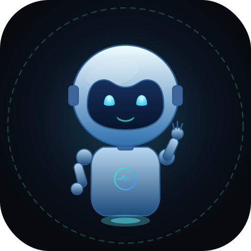

<p align="center"></p>
<h1 align="center">NoviArk</h1>
<p align="center">
<b>Agente de IA que escribe, ejecuta, prueba y corrige programas en tu computadora.</b><br>
<b>An AI agent that writes, runs, tests and fixes programs on your computer.</b>
</p>

<p align="center">


<a href="LICENSE.md"></a>
</p>

<p align="center">
<a href="#-ejecutar-desde-el-código"><b>Ejecutar</b></a> ·
<a href="#-qué-hace"><b>Qué hace</b></a> ·
<a href="#-español">Español</a> ·
<a href="#-english">English</a> ·
<a href="ROADMAP.md">Hoja de ruta</a> ·
<a href="CHANGELOG.md">Cambios</a>
</p>

> **Estado / Status:** NoviArk está en desarrollo. Todavía **no hay instaladores publicados**: por ahora se ejecuta desde el código, como se explica abajo. / NoviArk is under development. **No installers are published yet**: for now, run it from the source code, as explained below.

---

## 🇪🇸 Español

NoviArk es un programa de escritorio que recibe lo que quieres construir, crea el proyecto, escribe el código, lo ejecuta, lee los errores y los corrige. Funciona con modelos de IA en la nube (por ejemplo NVIDIA, Google Gemini, OpenAI, Anthropic, OpenRouter) o con **modelos locales** en tu PC (Ollama y LM Studio), sin que tu código salga de tu equipo cuando usas modelos locales.

### ▶ Ejecutar desde el código

Necesitas **Python 3.10 o superior**.

```bash
git clone https://github.com/JUXN1988/noviark.git
cd noviark
# Windows: doble clic en iniciar.bat   (crea el entorno .venv y abre la app)
# Linux / macOS:
bash iniciar.sh
```

La app abre una ventana nativa. También puedes usar `python app.py` y abrir `http://127.0.0.1:7860` en el navegador.

Después entra en **⚙ Ajustes → Proveedores y claves**, pega la API key de un proveedor (o conecta Ollama / LM Studio) y empieza a conversar.

### ✨ Qué hace

- **Agente con 40 herramientas**: crear y editar archivos, buscar en el código, ejecutar PowerShell, Python y comandos de Linux, administrar procesos, hacer peticiones HTTP, buscar y leer páginas web, descargar archivos, generar imágenes, captura de pantalla, abrir archivos y programas, y usar un navegador automatizado.
- **Plan antes de actuar**: el agente hace un plan de trabajo. Puedes editarlo o aprobarlo antes de que se ejecute; si no haces nada, se aprueba automáticamente tras una cuenta regresiva.
- **Se prueba a sí mismo**: `diagnosticar` revisa el proyecto y reporta problemas con archivo y línea; `probar_web` abre webs y juegos en un navegador invisible y revisa errores de JavaScript, archivos que no cargan y si los controles responden.
- **Guardián de razonamiento**: si un modelo piensa demasiado sin actuar o entra en bucle, NoviArk lo corta y lo obliga a actuar.
- **Escalado**: si el agente se atasca, pasa el trabajo al modelo más capaz que tengas habilitado.
- **Trabajo por etapas**: guarda el estado del trabajo (objetivo, plan, lo hecho, archivos y errores). Si un modelo falla o se queda sin cuota, el siguiente continúa desde ahí.
- **Varios proyectos**, cada uno con su propia pantalla y su propio modelo. Puedes importar proyectos que ya tengas en tu PC.
- **Servidores MCP**: usa el mismo formato de configuración que Claude Desktop (`datos/mcp.json`).
- **Seguridad**:
  - Modos de permiso: `preguntar`, `auto_seguro` y `auto`.
  - Antes de modificar, crea copias y puntos de restauración que puedes volver a usar.
  - Al eliminar, los archivos van a la Papelera de reciclaje.
  - Escáner de secretos que revisa los proyectos en busca de claves filtradas.
  - Las API keys se guardan en `claves.vault`. En Windows se cifran con DPAPI, así que solo tu usuario de Windows en esa PC puede leerlas. En otros sistemas están ofuscadas y con permisos 600; no están cifradas.
- **Proveedores de IA**: NVIDIA, Google Gemini, OpenAI, Anthropic, OpenRouter, Groq, DeepSeek, Mistral, xAI, Cerebras, Hugging Face, Cohere, Cloudflare Workers AI, Ollama Cloud, Vercel AI Gateway, entre otros, y cualquier API compatible con OpenAI. Puedes guardar varias claves por proveedor.
- **IA local**: Ollama y LM Studio, con el tamaño de contexto ajustado a la memoria de tu equipo.
- **Interfaz en español e inglés.**

Plataformas en las que se ejecuta desde el código: Windows, Linux y macOS.

### 📄 Licencia

NoviArk se distribuye bajo la **Noviark Community License 1.0** (ver [LICENSE.md](LICENSE.md)). Es **gratis para uso personal, educativo, de investigación y sin fines de lucro**. Las empresas pueden evaluarlo hasta 60 días; el uso comercial continuado requiere una licencia comercial.

---

## 🇬🇧 English

NoviArk is a desktop app that takes what you want to build, creates the project, writes the code, runs it, reads the errors and fixes them. It works with cloud AI models (for example NVIDIA, Google Gemini, OpenAI, Anthropic, OpenRouter) or with **local models** on your computer (Ollama and LM Studio); when you use local models, your code stays on your machine.

### ▶ Run from source

You need **Python 3.10 or newer**.

```bash
git clone https://github.com/JUXN1988/noviark.git
cd noviark
# Windows: double-click iniciar.bat   (creates .venv and opens the app)
# Linux / macOS:
bash iniciar.sh
```

The app opens in a native window. You can also run `python app.py` and open `http://127.0.0.1:7860` in your browser.

Then go to **⚙ Settings → Providers & keys**, paste an API key from a provider (or connect Ollama / LM Studio) and start a conversation.

### ✨ What it does

- **Agent with 40 tools**: create and edit files, search code, run PowerShell, Python and Linux commands, manage processes, make HTTP requests, search and read web pages, download files, generate images, take screenshots, open files and programs, and use an automated browser.
- **Plan before acting**: the agent drafts a work plan. You can edit or approve it before it runs; if you do nothing, it is approved automatically after a countdown.
- **Tests its own work**: `diagnosticar` checks the project and reports problems with file and line; `probar_web` opens web apps and games in an invisible browser and checks for JavaScript errors, files that fail to load and whether controls respond.
- **Reasoning guardian**: if a model thinks too long without acting or gets stuck in a loop, NoviArk stops it and makes it act.
- **Escalation**: if the agent gets stuck, the work moves to the most capable model you have enabled.
- **Resumable work**: it keeps the state of the work (goal, plan, what is done, files and errors). If a model fails or runs out of quota, the next one continues from there.
- **Several projects**, each with its own screen and model. You can import projects you already have on your PC.
- **MCP servers**: same configuration format as Claude Desktop (`datos/mcp.json`).
- **Safety**:
  - Permission modes: `preguntar` (ask), `auto_seguro` (safe auto) and `auto`.
  - Restore points are created before changes and can be restored.
  - Deleted files go to the Recycle Bin.
  - A secret scanner checks projects for leaked keys.
  - API keys are stored in `claves.vault`. On Windows they are encrypted with DPAPI, so only your Windows user on that PC can read them. On other systems they are obfuscated and set to permission 600; they are not encrypted.
- **AI providers**: NVIDIA, Google Gemini, OpenAI, Anthropic, OpenRouter, Groq, DeepSeek, Mistral, xAI, Cerebras, Hugging Face, Cohere, Cloudflare Workers AI, Ollama Cloud, Vercel AI Gateway, among others, and any OpenAI-compatible API. You can store several keys per provider.
- **Local AI**: Ollama and LM Studio, with the context size adjusted to your computer's memory.
- **Interface in Spanish and English.**

Runs from source on Windows, Linux and macOS.

### 📄 License

NoviArk is distributed under the **Noviark Community License 1.0** (see [LICENSE.md](LICENSE.md)). It is **free for personal, educational, research and non-profit use**. Companies may evaluate it for up to 60 days; continued commercial use requires a commercial license.

---

<p align="center">© 2026 Noviark Labs</p>
