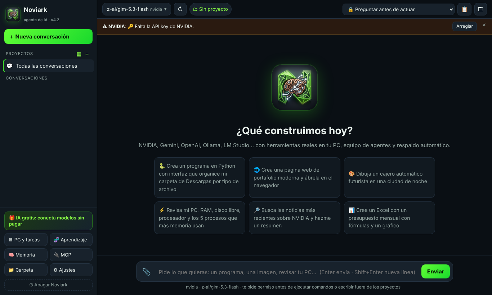
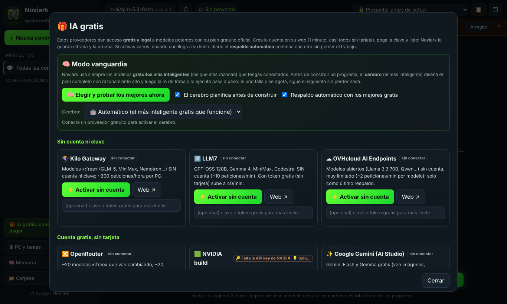
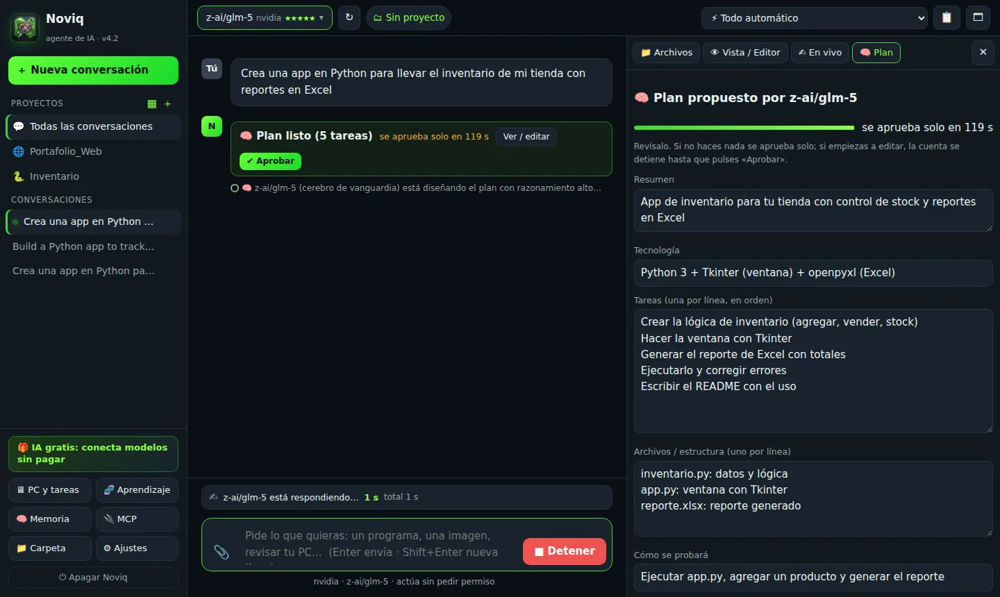
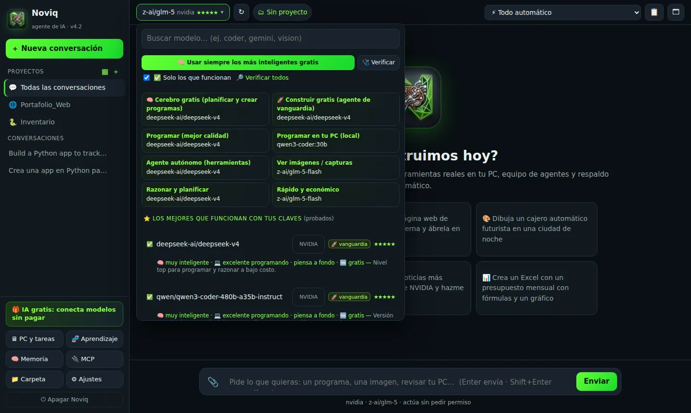
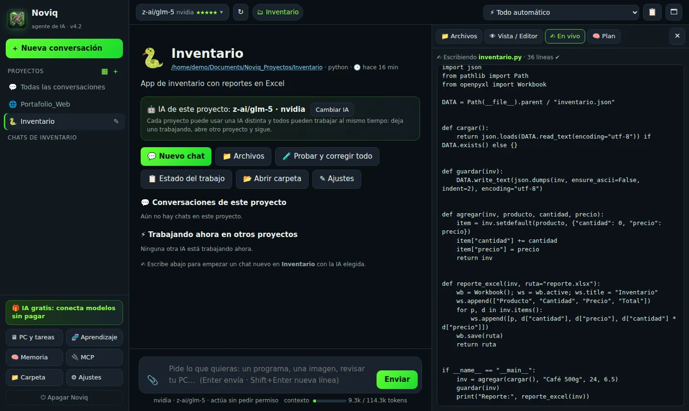
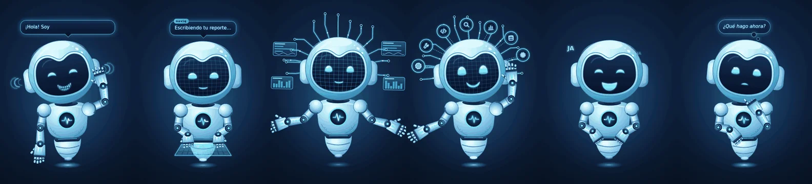

<p align="center"></p>
<h1 align="center">NoviQ</h1>
<p align="center">
<b>Agente de IA que escribe, ejecuta, prueba y corrige programas en tu computadora.</b><br>
<b>An AI agent that writes, runs, tests and fixes programs on your computer.</b>
</p>

<p align="center">
<a href="https://juxn1988.github.io/NoviQ/"><b>🌐 Visita la web del programa</b></a> · <a href="https://juxn1988.github.io/NoviQ/#ejecutar">Cómo ejecutarlo</a> · <a href="LICENSE.md">Licencia</a>
</p>

<p align="center">


<a href="LICENSE.md"></a>
</p>

<p align="center">
<a href="#-ejecutar"><b>Ejecutar</b></a> ·
<a href="#-capturas"><b>Capturas</b></a> ·
<a href="#-el-avatar-noviq-avatar"><b>Avatar</b></a> ·
<a href="#-comentarios-y-sugerencias"><b>Comentarios</b></a> ·
<a href="#-español">Español</a> ·
<a href="#-english">English</a>
</p>

> **⚠️ En actualización activa.** Estamos mejorando el programa y pueden existir pequeñas fallas que se están corrigiendo. Usa siempre la última versión del repositorio. / **Active development.** We are improving the app and minor bugs may exist while we fix them. Always use the latest version of the repository.

---

## 🇪🇸 Español

NoviQ es un programa de escritorio que recibe lo que quieres construir, crea el proyecto, escribe el código, lo ejecuta, lee los errores y los corrige. Funciona con modelos de IA en la nube (NVIDIA, Google Gemini, OpenAI, Anthropic, OpenRouter y más) o con **modelos locales** en tu PC (Ollama y LM Studio); con modelos locales, tu código no sale de tu equipo.

El repositorio tiene dos partes:

- **NoviQ** (la raíz): el programa principal.
- **[noviq-avatar](noviq-avatar/README.md)**: un robot asistente de escritorio que flota sobre tus programas, tiene su propia memoria y voz, y se conecta con NoviQ para mostrar en qué está trabajando.

### ▶ Ejecutar

Necesitas **Python 3.10 o superior**.

```bash
git clone https://github.com/JUXN1988/noviark.git
cd noviark
# Windows: doble clic en iniciar.bat   (crea el entorno .venv y abre la app)
# Linux / macOS:
bash iniciar.sh
```

La app abre una ventana nativa. También puedes ejecutar `python app.py` y abrir `http://127.0.0.1:7860` en el navegador.

Para el avatar, en Windows entra a `noviq-avatar` y haz doble clic en `iniciar.bat`. La primera vez necesita Node.js.

Luego entra en **⚙ Ajustes → Proveedores y claves**, pega la API key de un proveedor (o conecta Ollama / LM Studio) y empieza a conversar.

### 📸 Capturas

<p align="center"></p>
<p align="center"></p>
<p align="center"></p>
<p align="center">&nbsp;</p>
<p align="center"></p>

### ✨ Qué hace

- **📥 Pídele más mientras trabaja (nuevo en 4.7)**: si la IA o los agentes están trabajando y escribes algo más (en la ventana, por voz al avatar, por Telegram o por MCP), el pedido entra en la bandeja de esa conversación y se **integra al plan en el siguiente paso**, sin detener nada. En la ventana, el botón cambia a **📥 Agregar** y ves lo que está en cola.
- **🧭 Conversaciones que no se mezclan (nuevo en 4.7)**: cada pedido va a donde corresponde: sigue la misma conversación, retoma otra («sigue con lo del login»), abre una nueva («nueva conversación: …» / «otro tema…»), trabaja dentro del proyecto que nombras o crea un proyecto nuevo. Con el avatar y Telegram decide solo; en la ventana nunca te cambia de chat sin pedirlo.
- **🏷 Títulos automáticos (nuevo en 4.7)**: el primer pedido de cada conversación se resume en un título corto.
- **Agente con 62 herramientas**: crear y editar archivos, buscar en el código, ejecutar PowerShell, Python y comandos de Linux, administrar procesos, hacer peticiones HTTP, buscar y leer páginas web, descargar archivos, generar imágenes, captura de pantalla, abrir archivos y programas, usar un navegador automatizado, y herramientas de juegos, oficina y Windows.
- **Estudio de juegos** 2D, 3D y voxel, con modelos 3D propios.
- **Telegram, correo y agenda**: pídele trabajos y aprueba permisos desde el celular, y programa tareas.
- **Plan antes de actuar**: el agente hace un plan de trabajo que puedes editar o aprobar. Si no haces nada, se aprueba automáticamente tras una cuenta regresiva.
- **Se prueba a sí mismo**: `diagnosticar` revisa el proyecto y reporta problemas con archivo y línea; `probar_web` abre webs y juegos en un navegador invisible y revisa errores de JavaScript, archivos que no cargan y si los controles responden.
- **Guardián de razonamiento**: si un modelo piensa demasiado sin actuar o entra en bucle, NoviQ lo corta y lo obliga a actuar.
- **Escalado**: si el agente se atasca, pasa el trabajo al modelo más capaz que tengas habilitado.
- **Trabajo que no se pierde**: guarda el estado (objetivo, plan, lo hecho, archivos y errores). Si un modelo falla o se queda sin cuota, el siguiente continúa desde ahí.
- **Varios proyectos**, cada uno con su pantalla y su modelo. Puedes importar proyectos que ya tengas en tu PC.
- **Servidores MCP**: mismo formato de configuración que Claude Desktop (`datos/mcp.json`).
- **Seguridad**:
  - Modos de permiso: `preguntar`, `auto_seguro` y `auto`.
  - Copias y puntos de restauración antes de los cambios.
  - Los archivos eliminados van a la Papelera de reciclaje.
  - Escáner de secretos que revisa los proyectos en busca de claves filtradas.
  - Las API keys se guardan en `claves.vault`. En Windows se cifran con DPAPI, así que solo tu usuario de Windows en esa PC puede leerlas. En otros sistemas están ofuscadas y con permisos 600; no están cifradas.
- **Proveedores de IA**: NVIDIA, Google Gemini, OpenAI, Anthropic, OpenRouter, Groq, DeepSeek, Mistral, xAI, Cerebras, Hugging Face, Cohere, Cloudflare Workers AI, Ollama Cloud, Vercel AI Gateway y cualquier API compatible con OpenAI. Puedes guardar varias claves por proveedor.
- **IA local**: Ollama y LM Studio, con el contexto ajustado a la memoria de tu equipo.
- **Interfaz en español e inglés.**

### 🤖 El avatar (noviq-avatar)

Un robot que vive encima de tus programas, con fondo transparente. Tiene su propia mente, memoria, voz y oído, y puede usar las herramientas de NoviQ cuando está abierto.

<p align="center"></p>

| Estado | Qué hace el robot |
|---|---|
| 👋 Saluda | Se presenta y saluda cuando lo abres. |
| ✍️ Trabaja | Pone cara de concentrado cuando NoviQ empieza un trabajo y escribe en su panel. |
| 🛠 Usa herramientas | Muestra un icono en su visor según la herramienta: código, lupa, terminal o web. |
| ❓ Pide permiso o ayuda | «Necesito tu permiso…» o «Necesito tu ayuda…», y le respondes hablando. |
| ✅ Termina | Dice «¡Ya terminé!» y pregunta qué más hacemos. |

Además: **permisos por voz** (responde sí o no sin decir su nombre), **tareas a la vista** (barra de progreso con la tarea actual), **API compatible con OpenAI** para usarlo desde otras apps, y servidor **MCP**.

### 💬 Comentarios y sugerencias

Como el proyecto está en actualización, tu opinión ayuda mucho:

- **Reportar un error:** [abre un issue de error](https://github.com/JUXN1988/noviark/issues/new?template=bug_report.yml)
- **Proponer una mejora:** [abre una sugerencia](https://github.com/JUXN1988/noviark/issues/new?template=feature_request.yml)
- **Ver lo que se está corrigiendo:** [issues abiertos](https://github.com/JUXN1988/noviark/issues)

### 📄 Licencia

NoviQ se distribuye bajo la **Licencia NoviQ de Uso Personal 1.0** (ver [LICENSE.md](LICENSE.md)). Es **gratis para uso personal**. Cualquier **uso comercial** (de empresas, organizaciones, microempresas o trabajo por cuenta propia que genere ingresos) requiere una **licencia comercial de pago**. Para solicitarla, abre un issue con la etiqueta *business*. No es software de código abierto: el código es visible, pero el uso comercial es de pago.

El avatar (`noviq-avatar`) usa la misma licencia; su copia está en [noviq-avatar/LICENSE.md](noviq-avatar/LICENSE.md).

---

## 🇬🇧 English

NoviQ is a desktop app that takes what you want to build, creates the project, writes the code, runs it, reads the errors and fixes them. It works with cloud AI models (NVIDIA, Google Gemini, OpenAI, Anthropic, OpenRouter and more) or with **local models** on your computer (Ollama and LM Studio); with local models, your code stays on your machine.

The repository has two parts:

- **NoviQ** (the root): the main app.
- **[noviq-avatar](noviq-avatar/README.md)**: a desktop robot assistant that floats above your programs, has its own memory and voice, and connects to NoviQ to show what it is working on.

### ▶ Run

You need **Python 3.10 or newer**.

```bash
git clone https://github.com/JUXN1988/noviark.git
cd noviark
# Windows: double-click iniciar.bat   (creates .venv and opens the app)
# Linux / macOS:
bash iniciar.sh
```

The app opens in a native window. You can also run `python app.py` and open `http://127.0.0.1:7860` in your browser.

For the avatar on Windows, go to `noviq-avatar` and double-click `iniciar.bat`. The first run needs Node.js.

Then go to **⚙ Settings → Providers & keys**, paste an API key from a provider (or connect Ollama / LM Studio) and start a conversation.

### 📸 Screenshots

<p align="center"></p>
<p align="center"></p>
<p align="center"></p>
<p align="center">&nbsp;</p>
<p align="center"></p>

### ✨ What it does

- **📥 Ask for more while it works (new in 4.7)**: if the AI or the agents are working and you type something else (in the window, by voice to the avatar, by Telegram or by MCP), the request goes into that conversation's inbox and is **merged into the plan at the next step**, without stopping anything. In the window, the button turns into **📥 Add** and you see what is queued.
- **🧭 Conversations that don't mix (new in 4.7)**: each request goes where it belongs: it continues the same conversation, resumes another one («continue with the login»), opens a new one («new conversation: …»), works inside the project you name, or creates a new project. With the avatar and Telegram it decides on its own; in the window it never switches your chat unless you ask.
- **🏷 Automatic titles (new in 4.7)**: the first request of each conversation is summarized in a short title.
- **Agent with 62 tools**: create and edit files, search code, run PowerShell, Python and Linux commands, manage processes, make HTTP requests, search and read web pages, download files, generate images, take screenshots, open files and programs, use an automated browser, plus game, office and Windows tools.
- **Game studio** for 2D, 3D and voxel games, with its own 3D models.
- **Telegram, email and schedule**: send jobs and approve permissions from your phone, and schedule tasks.
- **Plan before acting**: the agent drafts a work plan you can edit or approve. If you do nothing, it is approved automatically after a countdown.
- **Tests its own work**: `diagnosticar` checks the project and reports problems with file and line; `probar_web` opens web apps and games in an invisible browser and checks for JavaScript errors, files that fail to load and whether controls respond.
- **Reasoning guardian**: if a model thinks too long without acting or loops, NoviQ stops it and makes it act.
- **Escalation**: if the agent gets stuck, the work moves to the most capable model you have enabled.
- **Work that is not lost**: keeps the state (goal, plan, done, files, errors). If a model fails or runs out of quota, the next one continues from there.
- **Several projects**, each with its own screen and model. You can import projects you already have on your PC.
- **MCP servers**: same configuration format as Claude Desktop (`datos/mcp.json`).
- **Safety**:
  - Permission modes: `preguntar` (ask), `auto_seguro` (safe auto) and `auto`.
  - Backups and restore points before changes.
  - Deleted files go to the Recycle Bin.
  - A secret scanner checks projects for leaked keys.
  - API keys are stored in `claves.vault`. On Windows they are encrypted with DPAPI, so only your Windows user on that PC can read them. On other systems they are obfuscated with permission 600; they are not encrypted.
- **AI providers**: NVIDIA, Google Gemini, OpenAI, Anthropic, OpenRouter, Groq, DeepSeek, Mistral, xAI, Cerebras, Hugging Face, Cohere, Cloudflare Workers AI, Ollama Cloud, Vercel AI Gateway and any OpenAI-compatible API. You can store several keys per provider.
- **Local AI**: Ollama and LM Studio, with the context size adjusted to your computer's memory.
- **Interface in Spanish and English.**

### 🤖 The avatar (noviq-avatar)

A robot that lives above your programs with a transparent background. It has its own mind, memory, voice and hearing, and can use NoviQ's tools when NoviQ is open.

<p align="center"></p>

| State | What the robot does |
|---|---|
| 👋 Greets | Introduces itself and says hello when you open it. |
| ✍️ Works | Looks focused when NoviQ starts a job and writes in its panel. |
| 🛠 Uses tools | Shows an icon on its visor for the tool in use: code, magnifier, terminal or web. |
| ❓ Asks permission or help | «I need your permission…» or «I need your help…», and you answer by voice. |
| ✅ Finishes | Says «Done!» and asks what to do next. |

Also: **voice permissions** (answer yes or no without saying its name), **tasks at a glance** (progress bar with the current task), an **OpenAI-compatible API** to use it from other apps, and an **MCP** server.

### 💬 Comments and suggestions

Since the project is being updated, your feedback helps a lot:

- **Report a bug:** [open a bug issue](https://github.com/JUXN1988/noviark/issues/new?template=bug_report.yml)
- **Suggest an improvement:** [open a feature request](https://github.com/JUXN1988/noviark/issues/new?template=feature_request.yml)
- **See what is being fixed:** [open issues](https://github.com/JUXN1988/noviark/issues)

### 📄 License

NoviQ is distributed under the **NoviQ Personal Use License 1.0** (see [LICENSE.md](LICENSE.md)). It is **free for personal use**. Any **commercial use** (by companies, organizations, microenterprises or self-employed people earning income) requires a **paid commercial license**. To request one, open an issue labeled *business*. This is not open-source software: the code is visible, but commercial use is paid.

The avatar (`noviq-avatar`) uses the same license; its copy is in [noviq-avatar/LICENSE.md](noviq-avatar/LICENSE.md).

---

<p align="center">© 2026 NoviQ Labs</p>
