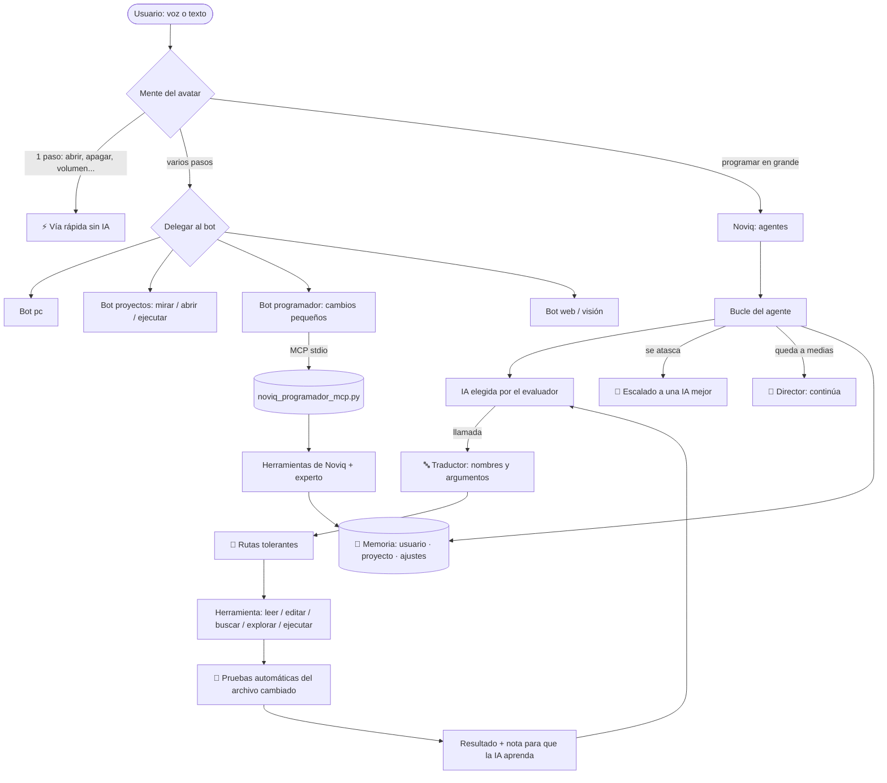
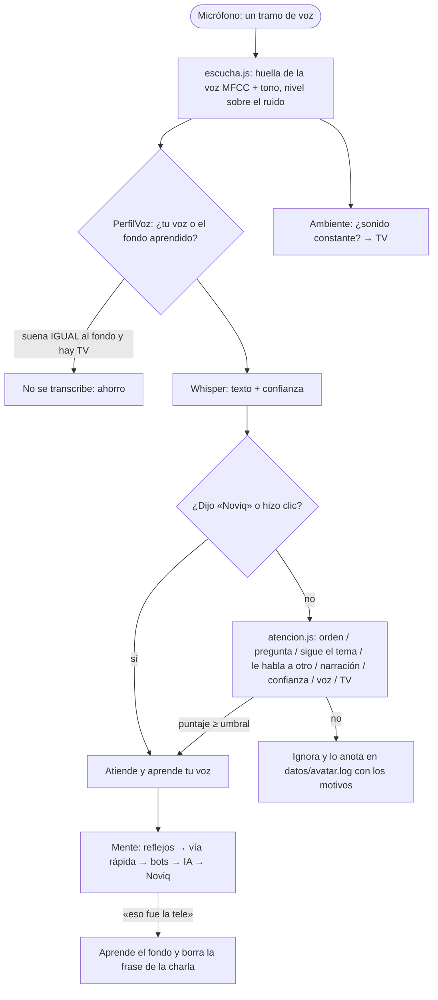
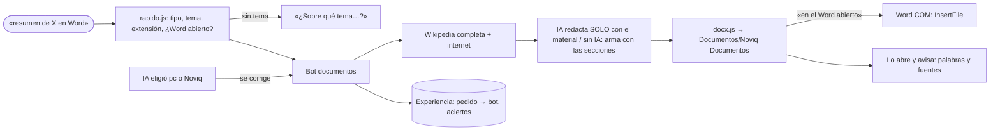
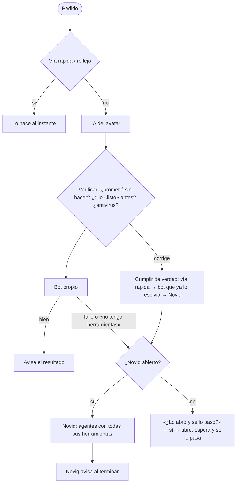
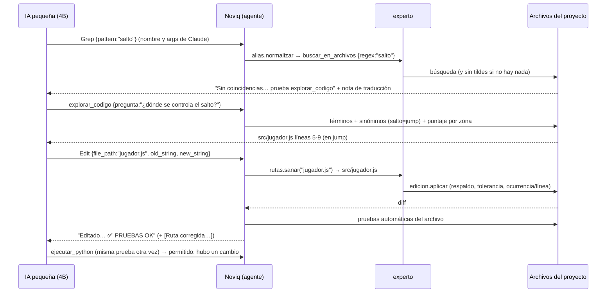
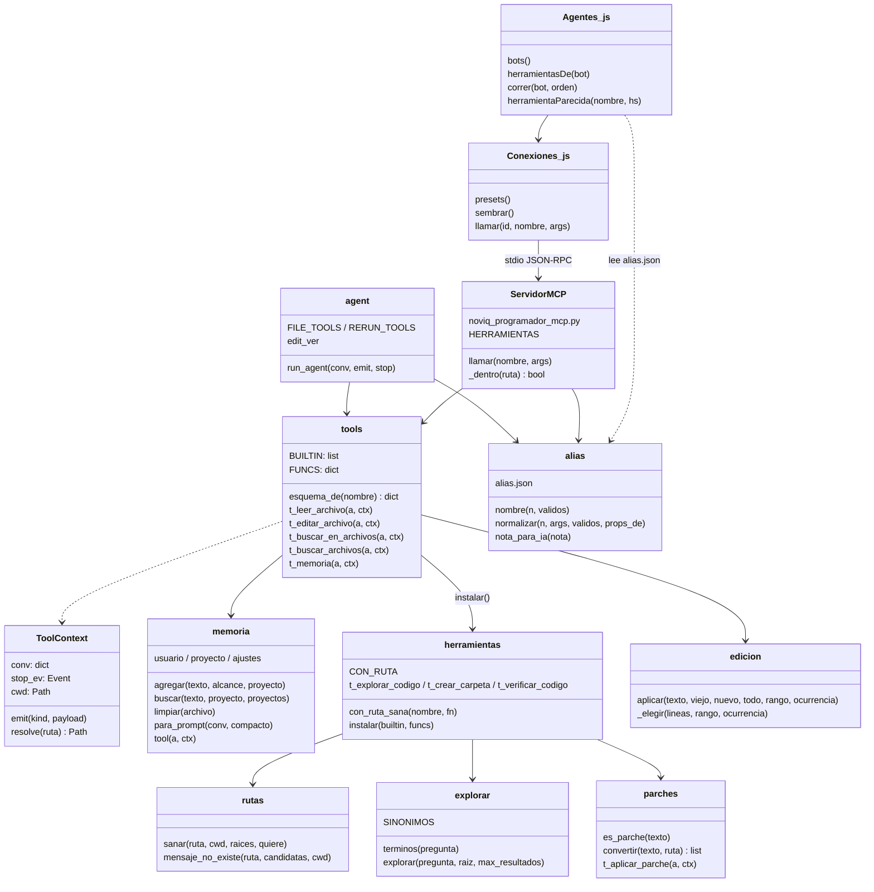

# Arquitectura de bots de Noviq y del avatar (10-10-2026)

Los diagramas están en Mermaid: se ven en GitHub, en VS Code (con la extensión Markdown Preview Mermaid) y en Obsidian.

## 1. Bots agrupados por función

| Función | Avatar (Node/Electron) | Noviq (Python) |
|---|---|---|
| **Interacción con el usuario** | `mente.js` (bot principal: siempre contesta y reparte), `voz/`, `oido`, `personalidad.js` | `agent.py` (chat con herramientas), `intencion.py` (detector de juegos), `prompts.py` (taller de prompts), `voz.py` |
| **Programación** | **bot `programador`** (MCP `noviq_programador_mcp.py`) · bot `proyectos` (mirar/abrir/ejecutar) · encargo a Noviq | `agent.py` + **`experto/`** (traductor, rutas, explorar, parches) · `compacto.py` (IA local) · `subagente.py` (equipo) · `cerebro.py` (plan) · `ejecutor.py` |
| **Gestión de datos y memoria** | `memoria.js` (usuario, planes, charla) | **`experto/memoria.py`** (usuario · proyecto · ajustes) · `estado.py` (ESTADO DEL TRABAJO) · `aprendizaje.py` (lecciones) · `indice.py` (mapa del código) · `versiones.py` (versiones, biblioteca, entregas) |
| **Mantenimiento y calidad** | `agentes.js` → `Permisos` (auditoría `acciones.log`) | `pruebas.py` (pruebas tras cada cambio) · `diagnostico.py` · `evaluador.py` (ranking de IAs) · `banco.py` · `salud.py` · `guardian.py` · `director.py` · `escalado.py` · `recursos.py` (no colapsar la PC) · `guardia.py` (aprobaciones) |
| **Documentos** | **bot `documentos`** (`documentos.js` + `docx.js`): investiga, redacta, crea .docx, escribe en el Word abierto | `herr_windows.py` (oficina) |
| **PC y servicios** | bots `pc` (vía rápida + PowerShell con permisos), `web`, `vision` · `rapido.js` · `localizador.js` | `pc.py`, `navegador.py`, `herr_windows.py` (oficina, correo, agenda, Telegram), `nvidia.py`, `juegos.py` |

Reglas para que no choquen:
- **Una sola lista de nombres** (`noviq/experto/alias.json`), que leen los dos programas.
- **Una sola implementación de las herramientas de código:** el avatar usa las de Noviq por MCP, no copias.
- **Respaldos compartidos:** lo que cambia el avatar aparece en `versiones_archivo` de Noviq.
- **El avatar nunca toca la bóveda de Noviq:** `NOVIQ_SIN_BOVEDA` en el servidor MCP y bloqueos en `mcp-interno.js`.

## 2. Flujo de una orden



### 2.1 Oído: ¿me hablan a mí? (avatar 2.5)



### 2.2 Documentos



### 2.3 Autónomo solo, Noviq para lo que no puede (avatar 2.6)



## 3. Ciclo del programador eficiente (IA pequeña)



## 4. Diagrama de clases (lo nuevo y con qué se conecta)



## 5. Seguridad (resumen)

| Riesgo | Protección |
|---|---|
| Una IA escribe fuera de los proyectos | El MCP rechaza rutas fuera de `all_roots()`. Las rutas corregidas solo buscan dentro del proyecto o de la carpeta de proyectos. |
| Leer claves | El MCP rechaza `.env`, `.token`, `claves.*`, `.pem`, `.key`, `id_rsa`… La memoria rechaza textos con forma de clave. El proceso MCP no puede abrir la bóveda (`NOVIQ_SIN_BOVEDA`). |
| Antivirus (incidente del 01-10) | Ni el avatar ni el MCP usan DPAPI ni `-EncodedCommand`. La carpeta Documentos se lee con la API de Windows, sin abrir PowerShell. |
| Ejecutar algo por error | El MCP del programador no ejecuta comandos. Un bloque ```json``` solo se ejecuta si es casi toda la respuesta. Los alias nunca adivinan herramientas desconocidas (umbral 0,86–0,88). |
| Que la TV dé órdenes | Sin su nombre, la frase pasa por `atencion.js` (texto + voz + ambiente). Con TV, una orden sin nombre solo se hace si suena a tu voz. El perfil de voz guarda números, nunca audio. |
| Documentos | Solo crea archivos NUEVOS en `Documentos\Noviq Documentos` (nunca sobrescribe); escribir en tu Word abierto pide permiso de acción. El script de Word recibe la ruta por variable de entorno (sin `-EncodedCommand`). |
| Memoria hacia la IA | Solo lo relevante (≤ 1 100 caracteres); las líneas con forma de clave nunca se guardan ni se envían; las notas de Noviq se leen, no se escriben. |
| Perder código | Copia antes de cada cambio, `deshacer_cambio`, `versiones_archivo`. Los parches nunca borran archivos. |
